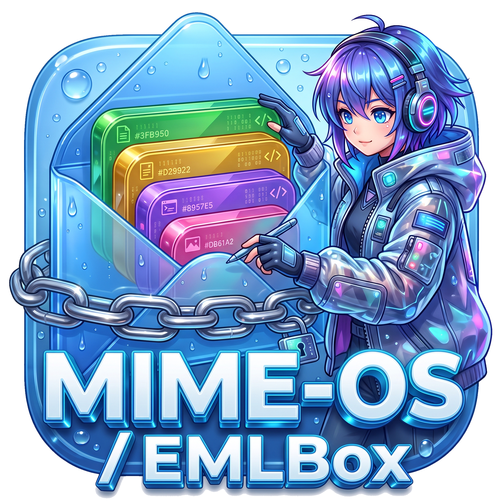

<div align="center">

# MIME-OS / EMLBox


### One file is the whole app.

**An environment where the atomic unit is not an `.exe`, not an ELF and not a closed
database — it is an RFC-822 `.eml` mail message. Code, GUI, state, KV data, binary assets
and an append-only hash-chained delta log live in one envelope that is read through `mmap`
by byte offsets and opens in any text editor.**

[](https://github.com/kostyk348/mime-os/actions/workflows/ci.yml)
[](https://github.com/kostyk348/mime-os/releases)
[](https://github.com/kostyk348/mime-os/commits/master)

**English** · [Русский](README.ru.md)

</div>

---

## What is MIME-OS / EMLBox?

A working prototype of an EML-native environment in Rust: one CLI (`emlbox`), a GUI viewer
(`emlbox-gui`) and an MCP server for LLMs (`rev-mcp`). Every artifact is a standard `.eml`
container — `cat` it, `grep` it, send it over SMTP, hand it to another machine as one file.
State is never rewritten in place: changes are appended to the same file as delta blocks,
and everything is addressed by byte offsets instead of a database. The concept grows out of
the **MIME-OS (EML-Native Architecture)** manifest: a flat tagged disk instead of a folder
hierarchy, an IPC bus made of `.eml` messages, one format for disk, memory and network.

- 📦 **Single-file containers** — one `.eml` = a whole app or entity: code, GUI, state, KV,
  raw binary assets.
- 🔗 **Hash-chained append-only log** — every change is a delta block linked by sha256;
  `verify` catches any tampering.
- ⚡ **Zero-copy reads** — envelope → two small indexes → payload is an mmap slice:
  6.2 ns per random-access section fetch, mount time flat in file size.
- 🔄 **Multi-writer delta-sync** — per-writer chains, LWW merge, idempotent delivery, over
  a spool bus or plain TCP.
- 🕸 **Flat tag-DB / EML-FS** — no folder hierarchy: "directories" are live queries over
  tags, not trees.
- ✉️ **Containers travel by mail** — the SMTP bridge packs deltas into letters; `watch`
  receives them from a Maildir in the background.

## What already works

| Real output (release build) | Containers, tagdb, verify |
| --- | --- |
|  | *one binary, zero dependencies* |

| Layer | Commands | What it does |
|---|---|---|
| **Container** | `create`, `mount`, `get`, `verify` | single-file .eml: mmap reader, two-level index, append-only delta log with hash-chain |
| **KV** | `kv get/set/del/dump` | NoSQL tables: base JSON + delta replay by seq |
| **Database/KV** (module 3) | `mkdb` | container-as-database: tables = MIME sections, byte-offset map |
| **AI/MemoryBank** (module 4) | `mkmem` | agent memory: LTM attachments + turns as deltas |
| **IPC bus** | `ipc send/list` | events are .eml messages in a spool directory |
| **Runner** | `run` | executes the container's `logic` section on bus events |
| **EML-FS** | `fs index/query/mkdir/dir/tag` | flat disk + header-scan index + virtual directories |
| **eml-tag** | `tagdb insert/query/bench` | flat tag database: header-only scan, corruption-proof |
| **Network (multi-writer sync)** | `sync export/push/pull/apply/heads` | delta-sync: per-writer chains, LWW merge, idempotent delivery, per-chain verify |
| **Network (TCP transport)** | `sync serve/connect` | P2P delta-sync over TCP (pure `std::net`): manifests, incremental block transfer |
| **Cellular reverse engineering** | `rev <binary> <dir>`, `rev report/stats/decomp-all/decomp --struct/field/...` | .eml function graph, mass decompilation of a whole binary (`decomp-all`), stats, decomp with parameters/fields |
| **Compaction** | `compact <c> [--out new]` | merges deltas into base: sections consolidate, chains reset to the convergence point |
| **Signatures** | `EMLBOX_SEED` env | ed25519 signature on every delta block; `verify` checks authenticity |
| **Repair** | `repair <c>` | recovery after a tear-write: tail rebuilt by block scan |
| **RGA lists** | `kv add/list` | conflict-free lists: insert by id, replicas converge |
| **X-Query OR/NOT** | `tagdb query`, `fs query` | OR and NOT at the top level of a query |
| **Mesh demo** | `sync serve/connect/converge/daemon` | live mesh: `daemon --peers` syncs automatically on a timer |
| **Collaborative documents** | `doc init/add/set/del/list/edit/log/revert` | CRDT document: edit in `$EDITOR`, history, revert |
| **Home mesh** | `setup-home [--install]` | bookmark/note containers + daemon autostart (Hyprland `exec-once`) |
| **X-Encoding** | `create --enc aes\|deflate` | sections and deltas: deflate compression, aes-256-gcm encryption (key `EMLBOX_KEY`/`EMLBOX_PASS`) |
| **SMTP bridge** | `mail pack/apply/receive/watch` | containers travel as email; `watch` receives from a Maildir in the background |
| **Site generator** | `site new`, `site <posts> <out>` | posts are .eml containers → static site (mini-markdown) |
| **GUI** | `emlbox-gui [file]` (feature `gui`) | egui viewer: sections, deltas, KV, documents, the rev decompiler, verify |

The on-disk format is specified in [`docs/FORMAT.md`](docs/FORMAT.md).

---

## Practical scenarios

### 1. Single-file application (zero-install)

A game/utility is one `.eml`: GUI (html), logic (python), state (KV), sprites (raw binary).
Moving it to another machine — or into a messenger — is copying one file.

```bash
emlbox demo app.eml
emlbox ipc send bus app MOVE '{"dx":5,"dy":-3}'   # click in the GUI
emlbox run app.eml --bus bus --once               # logic runs, state is appended
emlbox kv get app.eml state x                     # 47 — state updated
```

### 2. A live AI agent with memory

Agent memory is an `AI/MemoryBank` container: long-term facts (attachments) + short-term
turns (append deltas, `X-Turn-ID` as the key). Every reply appends a delta to the end of
the file — the base is never rebuilt. A ready foundation for agents with persistent memory.

```bash
emlbox mkmem memory.eml
emlbox kv set memory.eml turns 90412 '{"role":"user","intent":"full_eml_architecture"}'
emlbox kv dump memory.eml turns
```

### 3. Telemetry / IoT / logs (eml-tag)

A flat tag database with no folder hierarchy and no SQLite. Every record is an atomic
`.eml`; search scans **headers only, never bodies**; inserts go through tmp+rename (a torn
write is impossible) — a power cut kills at most one record.

```bash
emlbox tagdb insert db '{"temp":24.5}' --id rec_1 --tag telemetry --tag status_ok --device node_01 --ts 1786528800
emlbox tagdb query db 'X-Tag == "telemetry" AND X-Device-ID == "node_01"'
emlbox tagdb query db 'X-Timestamp >= 1786528800 AND X-Timestamp < 1786528900'
```

### 4. Virtual file systems by tags (EML-FS)

No hierarchy — a flat disk and query-directories. A "folder" is a `.eml` with an `X-Query`
or an explicit `X-Contains-ID` list, so the same file can live in any number of "folders"
without copying. Tagging is itself a delta: `fs tag store game game` touches the delta log,
never the base.

### 5. One portable container instead of zip/apk/vpk

Any artifact — a project, a backup, a service config — packs into a single
self-describing `.eml` with a type, tags, code and data. Readable in 100 years (MIME is an
international standard), opens in a text editor, integrity provable via the hash-chain.

```bash
emlbox pack ./project app.eml my_project   # the whole folder -> one .eml (structure in section paths)
emlbox unpack app.eml ./restored          # back, byte for byte
emlbox verify app.eml                     # integrity
```

`unpack` rejects absolute paths and `..` (path-traversal guard) — containers are safe to
receive from the network.

### 6.–10. More of what the same primitives buy you

- **IPC bus as a task queue.** Local and network IPC are one format: a spool directory,
  dispatch by `To:`, unaddressed messages stay with the owner.
- **Audit log with a cryptographic chain.** Every container is an append-only log of
  sha256-linked blocks; `verify` recomputes the chain and catches any interference — ready
  for journals where proving immutability matters.
- **Zero-API data exchange.** One format for disk, memory and "the network": data never
  changes shape. Exchange = exchanging `.eml` envelopes; a server is just a listener that
  answers with a container of its own.
- **State for bots / simulations / agents.** Config, state, move history (deltas) and high
  scores in one file; syncing between devices = appending each other's deltas.
- **Readability and interop.** Every module except raw binary assets opens in `cat`, a
  notepad or a 1995 editor: headers → sections → delta log, structure visible.

---

## Container format

```
[0..H)      envelope RFC 822 (From/To/X-Entity-ID/X-EML-Type/X-Index-Offset...)
[H..I)      base multipart: data sections + head index (byte offsets of sections)
[I..TI)     delta blocks (append-only, hash-chain: X-Prev-Hash)
[TI..T)     tail index JSON (rewritten on every append)
[T..EOF)    trailer, fixed 512 bytes
```

Invariants:

1. **Stable offsets** — an append never touches the base prefix; existing sections are
   eternal.
2. **Scan-free reads** — envelope → head index → tail index (two small JSONs); the payload
   is a zero-copy mmap slice. Mount time does not depend on file size.
3. **Contiguous deltas** — blocks are laid out back-to-back with the tail index at the
   end, no dead holes.
4. **Hash-chain** — `X-Base-Hash` → each block's `X-Prev-Hash` → `X-Tail-Hash`; `verify`
   catches any tampering (there is a tamper test).

---

## Benchmarks

Measured, not invented: release build, tmpfs, rustc 1.90.

### Container: mount / random access / append

| Metric | Value |
|---|---|
| Mount (2000 files) | 13.9 µs/file |
| Mount 20 KB vs 4.1 MB | 0.71 ms vs 0.81 ms — **flat**, O(index), not O(file) |
| Random-access section (zero-copy) | 6.2 ns/fetch |
| Append delta (with fsync) | 75–149 µs (avg 95 µs) |
| 200 deltas | the file stays compact (82.7 KB) — no dead holes |

### eml-tag vs plain FS vs single-file container (n=2000, 64 KB bodies)

| Pattern | insert | query `X-Tag=="telemetry"` | read from disk |
|---|---|---|---|
| **eml-tag** (header-scan) | 43 µs/record | **10.0 ms** | **8.2 MiB** |
| flat FS (grep semantics) | 36 µs/record | 23.1 ms | 131 MiB |
| single-file container | — | 66.8 ms | 128 MB JSON parsed |

Takeaway: header-scan is 2.3× faster than flat and 6.7× faster than the container, while
reading 16× less data. With tiny bodies (≤2 KB) flat ≈ tagdb — scanning wins when the body
is much larger than the headers.

### Which pattern to pick

| Situation | Pattern |
|---|---|
| Few/medium record count, active edits, everything in one file | **container (KV)** |
| Large bodies, tag search, telemetry, many records | **eml-tag** |
| Plain files without an index | an ordinary FS |

---

## X-Query

One query language for containers, FS and tagdb:

```
field OP value [AND field OP value ...]
OP: ==  !=  >=  <=  >  <
field: a header name (X-Tag, X-Device-ID, X-Timestamp, X-EML-Type, ...)
```

- `X-Timestamp >= 1000 AND X-Timestamp < 2000` — numeric comparison
- `X-Tag == "telemetry"` — multiple tags: matches if **any** of them equals
- `X-Tag != "telemetry"` — matches if **none** equals (also when the field is absent)
- `Subject == "arcade"` — substring, case-insensitive
- Missing field: `==` does not match, `!=` matches

---

## Cell-level reverse engineering

Binary → `.eml` function graph via a fully local pipeline: `objdump -d` (binutils) →
parsing → every function becomes its own `.eml` with its call graph. No Ghidra, no IDA.

```bash
emlbox rev game.exe cells          # 13 functions -> cells/*.eml
emlbox rev graph cells             # main -> player_move, player_take_damage, ...
emlbox rev cluster cells player    # semantic search over name+body
emlbox rev type cells net_send arg1 void*       # label a type (tick 0)
emlbox rev wave cells net_send arg1 void* 3     # wave over References, call-site aware
emlbox rev types cells             # type map over the whole graph
emlbox rev hash cells net_send     # digest of the normalized body
emlbox rev diff cells_v1 cells_v2  # changed/added/removed between versions
```

A cell-function:

```
From: <net_send@binary.target@system.local>
Subject: net_send
X-EML-Type: Reverse/Binary-Function
References: fire_bullet, player_move, player_take_damage   # who calls it
X-Type-arg0: Packet                                        # wave type
Body: listing section (assembly)
```

The type wave is **call-site aware**: a mini dataflow (mov/lea chains, prologue slots
`[rbp-0x8]=saved parameter`, `[rip+..]` addresses). A caller is typed only if it really
passes its own parameter into the labelled argument: `player_take_damage` passes its
`Player*` into `net_send.arg1` → typed; `main` passes a local → honestly skipped. Version
diffing normalizes the body (addresses, hex bytes, `[rip+ADDR]`, comments) → only real
code changes are caught. v0.12–v0.15 added a pseudo-C decompiler on top (local variables,
if/else/while, struct fields), `rev report` and mass `decomp-all` — see the
[CHANGELOG](CHANGELOG.md).

**MCP server for LLMs**: `target/release/rev-mcp` (stdio JSON-RPC, 8 tools: get_function /
get_callers / get_callees / cluster / wave / types / diff / graph). The model reads only a
cell's neighbours, not the whole listing. Plug it into `opencode.json` as
`"rev-mcp": { "command": "/path/rev-mcp" }`.

---

## Getting started

Build from source (Rust stable):

```bash
git clone https://github.com/kostyk348/mime-os.git
cd mime-os
cargo build --release
```

> Fixed in this release cycle: the `emlbox` **binary** target and the `tests/sync.rs` suite
> compile again (a `let`-binding for E0716 in the `rev strings` handler;
> `Delta{id,after}` initializers updated). `cargo test` runs the full suite green
> again — 69 tests. See [CHANGELOG.md](CHANGELOG.md) → v0.16.0.

Quickstart:

```bash
./target/release/emlbox demo /tmp/game.eml     # single-file app (GUI+logic+KV+binary)
./target/release/emlbox mount /tmp/game.eml    # sections + deltas + hash-chain
./target/release/emlbox verify /tmp/game.eml   # integrity check
```

CLI reference:

```
emlbox create <path> <entity> <subject> [--part id:ct:name:file ...]
emlbox mount <path>
emlbox get <path> <id> [--out file]
emlbox kv get|set|del|dump <path> <table> [key] [json]
emlbox ipc send|list <bus> [<to> <event> [json]]
emlbox run <container> [--bus <dir>] [--once]
emlbox sync export|push|pull|apply|heads <container> [--writer W] [--bus DIR] [--to ENTITY] [--since N]
emlbox sync daemon <container> --addr :9001 --peers a,b [--interval 10]
emlbox sync serve <container> --addr :9001 | sync connect <container> --peer host:port
emlbox rev <binary> <dir>            # objdump -> .eml graph of functions
emlbox rev type|wave|cluster|graph|types|hash|diff <dir> [...]
emlbox mail pack|apply|receive       # SMTP bridge: letters with deltas
emlbox site new <post.eml> --title T --tags a,b --src body.md
emlbox site <posts> <out>            # build a static site
emlbox-gui <file.eml>                # GUI (cargo build --features gui)
emlbox doc init/add/set/del/edit/list <file>  # collaborative document; edit = edit in $EDITOR with auto-deltas
emlbox fs index|ls|query|mkdir|dir|tag <store> [...]
emlbox tagdb insert|query|bench <db> [...]
emlbox mkdb <path> [entity]          # X-EML-Type: Database/KV
emlbox mkmem <path> [entity]         # X-EML-Type: AI/MemoryBank
emlbox pack <dir> <out.eml> [entity] # directory -> one .eml (instead of zip/tar)
emlbox unpack <container> <out-dir>  # .eml -> files (path-traversal guard)
emlbox append <path> <delta-json-file>
emlbox verify <path>
emlbox demo <path> [--big]
emlbox bench <dir>
```

---

## Architecture

```
┌──────────────┐  emlp-event   ┌──────────────┐
│ view (html)  │ ────────────► │  IPC bus     │   .eml message spool directory
└──────────────┘   msg.eml    └──────┬───────┘
                                      │ To: == X-Entity-ID
                                      ▼
                              ┌──────────────┐    ops → deltas
                              │  EML-Runner  │ ──────────────────┐
                              │ (logic sect.)│                   ▼
                              └──────┬───────┘            ┌──────────────┐
                                     │ hal.emit()         │ game.eml     │
                                     ▼                    │ (one file:   │
                              ┌──────────────┐            │ view+logic+  │
                              │ other modules│            │ state+kv+    │
                              └──────────────┘            │ binary)      │
                                                          └──────────────┘

store/ (flat disk)                     db/ (eml-tag)
├── game.eml   [Application/Unified]  ├── rec_0001.eml  X-Tag: telemetry
├── games.eml  [System/Directory]     ├── rec_0002.eml  X-Tag: status_ok
│    X-Query: X-Tag == "game"         └── ...
└── docs.eml   [System/Directory]
     X-Contains-ID: <manual@system.local>
```

### Multi-writer sync between devices

Every device is an independent writer with its own delta chain; all chains converge on the
shared `X-Base-Hash`. Merge is LWW by time, deterministic on every device, and `verify`
checks each chain separately:

```bash
# device A

emlbox kv set game.eml state x 47 --writer devA
# device B

emlbox kv set game.eml state y 205 --writer devB

# B → bus → A

emlbox sync push devB.eml --writer devB --bus /dev/shm/bus --to game
emlbox sync pull devA.eml --bus /dev/shm/bus     # A receives the foreign deltas

# back: A → B

emlbox sync push devA.eml --writer devA --bus /dev/shm/bus --to game
emlbox sync pull devB.eml --bus /dev/shm/bus

emlbox sync heads devA.eml    # all writer chains
emlbox verify devA.eml        # clean
```

Re-delivered blocks are idempotent (dedup by writer#seq); out-of-order blocks stay pending
until their predecessor arrives (`pull` loops until things stabilise).

---

## Tests

```bash
cargo test            # the full suite: 69 tests, green
```

The suite covers format invariants, IPC + Runner, FS, tagdb, pack, network sync and
X-Query; the release notes counted it growing from 39 tests (v0.2) through 46 (v0.4) to 72
(v0.14.1). After the compile fixes of this cycle the whole suite (library + binary +
integration tests) builds and runs again.

## Releases

28 tagged releases between 2026-08-12 and 2026-09-13, then this docs release. Full notes
in [CHANGELOG.md](CHANGELOG.md).

| Version | What | When |
|---|---|---|
| **v0.16.0** | Docs & promo: README rewritten (EN + RU), CHANGELOG / LIMITATIONS / CONTRIBUTING added — no code changes | 2026-10-30 |
| **v0.15.0** | `rev decomp-all` — mass decompilation of a whole binary into one `.c`; `rev stats`. FTL: 288 ShipManager functions → 33k lines | 2026-09-13 |
| v0.14.2 | GUI: Rev tab — decompile a rev cell with a button (with struct fields) | 2026-08-23 |
| v0.14.1 | Struct field names: `rev field <dir> <func> 0x670 scrap`; decomp substitutes `[arg0+scrap]` | 2026-08-23 |
| v0.14.0 | Decompiler readability: parameters in the body (`rbx=rdi` → `arg0`), clobber tracking, prologue cleanup | 2026-08-23 |
| v0.13.1 | `rev report` — whole-binary summary (functions, vftables, strings, entropy, top callees) | 2026-08-23 |
| v0.13.0 | Decompiler v0.4 — local variables (`local_8`/`param_1`, Ghidra style); validated on libc `strlen` | 2026-08-23 |
| v0.12.3 | Decompiler: while loops (backward jcc), call arguments from `mov`, prologue cleanup | 2026-08-23 |
| v0.12.2 | Decompiler: conditions from `cmp`/`test` (`if (eax > 0)`), typed signatures from the wave | 2026-08-22 |
| v0.12.1 | CFG structuring — blocks by labels and conditional branches, if/else | 2026-08-22 |
| v0.12.0 | Decompiler (asm → pseudo-C lifter), `rev strings`, `rev dot` (Graphviz) | 2026-08-22 |
| v0.11.1 | `rev vftables` — automatic vtable search (runs of pointers in `.text`) | 2026-08-22 |
| v0.11.0 | `rev` on real binaries (libc: 2354 functions in 0.5 s) + `rev recon` | 2026-08-22 |
| v0.10.3 | `setup-home` — home mesh in one command (bookmarks + notes, Hyprland autostart) | 2026-08-22 |
| v0.10.2 | `mail watch` — background mail reception; full mobile loop: phone → email → Maildir → mesh | 2026-08-22 |
| v0.10.1 | GUI: Doc tab — view a document, add/revert buttons | 2026-08-22 |
| v0.10.0 | `sync daemon` — live mesh: nodes sync automatically on a timer | 2026-08-19 |
| v0.9.1 | `doc log` (change history), `doc revert`, `sync converge` | 2026-08-18 |
| v0.9.0 | `doc edit` — collaborative editor (edit in `$EDITOR`, LCS diff → deltas) | 2026-08-18 |
| v0.8.1 | Full CRDT document set — `list-set`/`list-del`, `doc set`/`doc del` | 2026-08-18 |
| v0.8.0 | Collaborative documents on .eml — `doc init/add/list` (RGA lines, lossless sync) | 2026-08-17 |
| v0.7.1 | X-Query OR/NOT, fsync mode (`EMLBOX_NO_FSYNC`), 3-node mesh demo | 2026-08-17 |
| v0.7.0 | `repair` (tear-write recovery), RGA lists (`kv add/list`) | 2026-08-17 |
| v0.6.0 | Compaction (deltas → base), ed25519 signatures (`EMLBOX_SEED`), rev hypothesis branches | 2026-08-17 |
| v0.5.0 | X-Encoding (deflate / aes-256-gcm), SMTP bridge, site generator, GUI (`emlbox-gui`) | 2026-08-16 |
| v0.4.0 | rev wave with call-site dataflow, version diff with body normalization, `rev-mcp` server (8 tools) | 2026-08-16 |
| v0.3.0 | Cellular reverse engineering without Ghidra: objdump → .eml graph, type waves, clusters | 2026-08-16 |
| v0.2.0 | Network delta-sync: per-writer chains, LWW replay, idempotent delivery, `sync` CLI | 2026-08-16 |
| v0.1.0 | First release: single-file .eml container OS stack | 2026-08-12 |

## Limitations (honest ones)

See [`LIMITATIONS.md`](LIMITATIONS.md). Notably: the Runner executes container logic with
**no sandbox**, KV merge is LWW (only lists are conflict-free RGA), there is no file
locking, sync has no TLS/auth on the wire yet, `rev` depends on `objdump`, and the binary
target currently needs a one-line fix to build.

## Roadmap

- ✅ Network delta-sync (v0.2) — per-writer chains, LWW merge, idempotent delivery
- ✅ ed25519 signatures over the hash-chain (v0.6, `EMLBOX_SEED`)
- ✅ Compaction — deltas merged into base (v0.6)
- ✅ RGA lists for conflict-free collections (v0.7); CRDT documents (v0.8–v0.9)
- ✅ X-Encoding: deflate + aes-256-gcm sections and deltas (v0.5)
- ✅ X-Query OR / NOT (v0.7.1)
- ⬜ Runner sandbox — seccomp / nsjail (logic currently runs as-is)
- ⬜ Reindex after text edits; WAL against tear-writes
- ⬜ X-Query nesting
- ⬜ SMTP mesh / QUIC as the sync transport (the format stays the same)

## Contributing

PRs welcome — see [`CONTRIBUTING.md`](CONTRIBUTING.md). Changes are tracked in
[`CHANGELOG.md`](CHANGELOG.md).

## Contributors

- **Konstantin** ([@kostyk348](https://github.com/kostyk348)) — creator, architecture,
  implementation, docs

## License

Apache-2.0 — see [`LICENSE`](LICENSE).

<div align="center">

**MIME-OS / EMLBox** — your data, sealed in mail.

</div>
