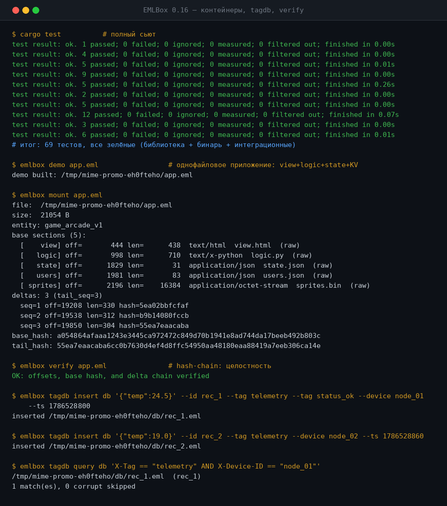

<div align="center">

# MIME-OS / EMLBox

### Один файл — и есть всё приложение.

**Операционная среда, в которой атомарный строительный блок — не `.exe`, не ELF и не
закрытая база данных, а RFC-822 MIME-документ. Код, GUI, состояние, KV-данные, бинарные
ассеты и append-only дельта-лог с hash-chain живут в одном конверте, который читается
через `mmap` по байт-оффсетам и открывается любым текстовым редактором.**

[](https://github.com/kostyk348/mime-os/releases)
[](https://github.com/kostyk348/mime-os/blob/master/LICENSE)
[](https://github.com/kostyk348/mime-os/commits/master)

[English](README.md) · **Русский**

</div>

---

## Что такое MIME-OS / EMLBox?

Рабочий прототип EML-нативной среды на Rust: один CLI (`emlbox`), GUI-просмотрщик
(`emlbox-gui`) и MCP-сервер для LLM (`rev-mcp`). Каждый артефакт — стандартный `.eml`
контейнер: открывается `cat`'ом, ищется `grep`'ом, уезжает по SMTP на другую машину как
один файл. Состояние никогда не переписывается на месте: изменения дописываются в тот же
файл дельта-блоками, а всё адресуется байт-оффсетами вместо базы данных. Концепция
развивается из манифеста **MIME-OS (EML-Native Architecture)**: плоский теговый диск
вместо иерархии папок, IPC-шина из `.eml`-сообщений, единый формат для диска, памяти и
сети.

- 📦 **Однофайловые контейнеры** — один `.eml` = целое приложение или сущность: код, GUI,
  состояние, KV, сырые бинарные ассеты.
- 🔗 **Append-only лог с hash-chain** — каждое изменение это дельта-блок со sha256-связкой;
  `verify` ловит любое вмешательство.
- ⚡ **Zero-copy чтение** — envelope → два маленьких индекса → payload это mmap-слайс:
  6.2 ns на random-access выборку секции, mount не зависит от размера файла.
- 🔄 **Multi-writer delta-sync** — per-writer chains, LWW merge, идемпотентная доставка,
  транспорт — spool-шина или чистый TCP.
- 🕸 **Плоский tag-DB / EML-FS** — нет иерархии папок: «директории» это живые запросы по
  тегам, а не деревья.
- ✉️ **Контейнеры путешествуют почтой** — SMTP-мост упаковывает дельты в письма; `watch`
  принимает их из Maildir в фоне.

## Что уже работает

| Реальный вывод (release-сборка) | Контейнеры, tagdb, verify |
| --- | --- |
|  | *один бинарь, ноль зависимостей* |

| Слой | Команды | Что делает |
|---|---|---|
| **Контейнер** | `create`, `mount`, `get`, `verify` | single-file .eml: mmap-ридер, two-level index, append-only дельта-лог с hash-chain |
| **KV** | `kv get/set/del/dump` | NoSQL-таблицы: base JSON + реплей дельт по seq |
| **Database/KV** (модуль 3) | `mkdb` | контейнер-БД: таблицы = MIME-секции, byte-offset map |
| **AI/MemoryBank** (модуль 4) | `mkmem` | память агента: LTM-вложения + turn'ы дельтами |
| **IPC-шина** | `ipc send/list` | события = .eml-сообщения в spool-директории |
| **Runner** | `run` | исполняет `logic`-секцию контейнера на событиях шины |
| **EML-FS** | `fs index/query/mkdir/dir/tag` | плоский диск + header-scan индекс + виртуальные директории |
| **eml-tag** | `tagdb insert/query/bench` | плоская теговая БД: header-only scan, corruption-proof |
| **Сеть (multi-writer sync)** | `sync export/push/pull/apply/heads` | delta-sync: per-writer chains, LWW merge, идемпотентная доставка, verify каждой цепочки |
| **Сеть (TCP transport)** | `sync serve/connect` | P2P delta-sync по TCP (чистый `std::net`): манифесты, инкрементальная передача блоков |
| **Клеточный реверс** | `rev <binary> <dir>`, `rev report/stats/decomp-all/decomp --struct/field/...` | .eml-граф функций, массовая декомпиляция всего бинарника (decomp-all), stats, декомп с параметрами/полями |
| **Compaction** | `compact <c> [--out new]` | слияние дельт в base: секции консолидируются, цепочки сбрасываются к точке схождения |
| **Подписи** | `EMLBOX_SEED` env | ed25519-подпись каждого дельта-блока, verify проверяет аутентичность |
| **Repair** | `repair <c>` | восстановление после tear-write: пересборка tail сканом блоков |
| **RGA-списки** | `kv add/list` | конфликт-free списки: вставка по id, реплики сходятся |
| **X-Query OR/NOT** | `tagdb query`, `fs query` | OR и NOT на верхнем уровне запроса |
| **Mesh-демо** | `sync serve/connect/converge/daemon` | живой mesh: `daemon --peers` синкается автоматически по таймеру |
| **Совместные документы** | `doc init/add/set/del/list/edit/log/revert` | CRDT-документ: правка в `$EDITOR`, история, откат |
| **Домашний mesh** | `setup-home [--install]` | контейнеры закладок/заметок + автозапуск демонов (Hyprland `exec-once`) |
| **X-Encoding** | `create --enc aes\|deflate` | секции и дельты: deflate-сжатие, aes-256-gcm шифрование (ключ `EMLBOX_KEY`/`EMLBOX_PASS`) |
| **SMTP-мост** | `mail pack/apply/receive/watch` | контейнеры путешествуют письмами; `watch` — фоновый приём из Maildir |
| **Сайт-генератор** | `site new`, `site <posts> <out>` | посты = .eml-контейнеры → статический сайт (mini-markdown) |
| **GUI** | `emlbox-gui [file]` (feature `gui`) | egui-просмотрщик: секции, дельты, KV, документы, декомпилятор rev, verify |

Формат на диске описан в [`docs/FORMAT.md`](docs/FORMAT.md).

---

## Практические сценарии

### 1. Однофайловое приложение (zero-install)

Игра/утилита = один `.eml`: GUI (html), логика (python), состояние (KV), спрайты
(raw-бинарь). Перенос на другую машину или в мессенджер — копирование одного файла.

```bash
emlbox demo app.eml
emlbox ipc send bus app MOVE '{"dx":5,"dy":-3}'   # клик в GUI
emlbox run app.eml --bus bus --once               # логика исполняется, состояние дописывается
emlbox kv get app.eml state x                     # 47 — состояние обновлено
```

### 2. Живой AI-агент с памятью

Память агента = контейнер `AI/MemoryBank`: долгосрочные факты (вложения) + краткосрочные
turn'ы (append-дельты, `X-Turn-ID` = ключ). Каждая реплика — дельта в конец файла, база не
пересобирается. Готовый фундамент для агентов с персистентной памятью.

```bash
emlbox mkmem memory.eml
emlbox kv set memory.eml turns 90412 '{"role":"user","intent":"full_eml_architecture"}'
emlbox kv dump memory.eml turns
```

### 3. Телеметрия / IoT / логи (eml-tag)

Плоская теговая БД без иерархии папок и без SQLite. Каждая запись — атомарный `.eml`,
поиск по заголовкам **без чтения тела** (header-only scan), вставка через tmp+rename
(torn-запись невозможна) — сбой питания убивает максимум одну запись.

```bash
emlbox tagdb insert db '{"temp":24.5}' --id rec_1 --tag telemetry --tag status_ok --device node_01 --ts 1786528800
emlbox tagdb query db 'X-Tag == "telemetry" AND X-Device-ID == "node_01"'
emlbox tagdb query db 'X-Timestamp >= 1786528800 AND X-Timestamp < 1786528900'
```

### 4. Виртуальные файловые системы по тегам (EML-FS)

Нет иерархии — есть плоский диск и директории-запросы. «Папка» — это `.eml` с `X-Query`
или явным списком `X-Contains-ID`, поэтому один и тот же файл может входить в сколько
угодно «папок» без копирования. Тегирование само по себе дельта: `fs tag store game game`
пишет в дельта-лог и не трогает base.

### 5. Универсальный переносимый контейнер (вместо zip/apk/vpk)

Любой артефакт — проект, бэкап, конфигурация сервиса — упаковывается в один
самодокументируемый `.eml` с типом, тегами, кодом и данными. Читается через 100 лет
(MIME — международный стандарт), открывается текстовым редактором, целостность
доказывается hash-chain.

```bash
emlbox pack ./project app.eml my_project   # вся папка -> один .eml (структура в путях секций)
emlbox unpack app.eml ./restored          # обратно, байт-в-байт
emlbox verify app.eml                     # целостность
```

`unpack` отвергает абсолютные пути и `..` (защита от path traversal) — контейнеры
безопасно получать из сети.

### 6.–10. Что ещё дают те же примитивы

- **IPC-шина как очередь задач.** Локальный и сетевой IPC — один и тот же формат:
  spool-директория, диспетчеризация по `To:`, не-адресованные сообщения остаются
  владельцу.
- **Аудит-лог с криптографической цепочкой.** Любой контейнер — append-only лог из
  sha256-связанных блоков; `verify` пересчитывает цепочку и ловит любое вмешательство —
  готово для журналов, где важно доказать неизменность.
- **Zero-API обмен данными.** Один формат для диска, памяти и «сети»: данные не меняют
  форму. Обмен = обмен `.eml`-конвертами; сервер — просто слушатель, который отвечает
  конвертом со своими секциями.
- **Состояние для ботов / симуляций / агентов.** Конфиг, состояние, история ходов
  (дельты) и highscore в одном файле; синк между устройствами = дописать чужие дельты.
- **Читаемость и интероп.** Любой модуль, кроме сырых бинарных ассетов, открывается
  `cat`'ом, блокнотом или редактором 1995 года: заголовки → секции → дельта-лог,
  структура видна.

---

## Формат контейнера

```
[0..H)      envelope RFC 822 (From/To/X-Entity-ID/X-EML-Type/X-Index-Offset...)
[H..I)      base multipart: секции данных + head index (байт-оффсеты секций)
[I..TI)     дельта-блоки (append-only, hash-chain: X-Prev-Hash)
[TI..T)     tail index JSON (переписывается при каждом append)
[T..EOF)    trailer, фиксированные 512 байт
```

Инварианты:

1. **Стабильные оффсеты** — append никогда не трогает base-префикс; существующие секции
   вечны.
2. **Чтение без скана** — envelope → head index → tail index (два маленьких JSON);
   payload = zero-copy mmap-слайс. Mount не зависит от размера файла.
3. **Контиг-дельты** — блоки лежат подряд, tail index в конце, без мёртвых дыр.
4. **Hash-chain** — `X-Base-Hash` → `X-Prev-Hash` каждого блока → `X-Tail-Hash`; `verify`
   ловит любое вмешательство (tamper-тест).

---

## Бенчмарки

Измерено, не выдумано: release-сборка, tmpfs, rustc 1.90.

### Контейнер: mount / random access / append

| Метрика | Значение |
|---|---|
| Mount (2000 файлов) | 13.9 µs/файл |
| Mount 20 КБ vs 4.1 МБ | 0.71 ms vs 0.81 ms — **flat**, O(индекс), не O(файл) |
| Random-access секции (zero-copy) | 6.2 ns/fetch |
| Append дельты (с fsync) | 75–149 µs (avg 95 µs) |
| 200 дельт | файл компактный (82.7 КБ) — без мёртвых дыр |

### eml-tag vs обычный FS vs single-file контейнер (n=2000, тело 64 КБ)

| Паттерн | insert | query `X-Tag=="telemetry"` | прочитано с диска |
|---|---|---|---|
| **eml-tag** (header-scan) | 43 µs/запись | **10.0 ms** | **8.2 MiB** |
| flat-FS (grep-семантика) | 36 µs/запись | 23.1 ms | 131 MiB |
| single-file контейнер | — | 66.8 ms | парс 128 МБ JSON |

Вывод: header-scan в 2.3× быстрее flat и в 6.7× быстрее контейнера, читая в 16× меньше
данных. При крошечных телах (≤2 КБ) flat ≈ tagdb — сканирование выигрывает, когда тело ≫
заголовков.

### Правило выбора паттерна

| Ситуация | Паттерн |
|---|---|
| Мало/средне записей, активные правки, всё в одном файле | **контейнер (KV)** |
| Крупные тела, теговый поиск, телеметрия, много записей | **eml-tag** |
| Простые файлы без индекса | обычный FS |

---

## X-Query

Один язык запросов для контейнеров, FS и tagdb:

```
поле OP значение [AND поле OP значение ...]
OP: ==  !=  >=  <=  >  <
поле: имя заголовка (X-Tag, X-Device-ID, X-Timestamp, X-EML-Type, ...)
```

- `X-Timestamp >= 1000 AND X-Timestamp < 2000` — численное сравнение
- `X-Tag == "telemetry"` — множественные теги: матч если **любой** равен
- `X-Tag != "telemetry"` — матч если **ни один** не равен (и если поле отсутствует)
- `Subject == "arcade"` — подстрока, регистронезависимо
- Отсутствующее поле: `==` не матчит, `!=` матчит

---

## Клеточный реверс (без Ghidra/IDA)

Бинарник → граф .eml-функций полным локальным конвейером: `objdump -d` (binutils) →
парсинг → каждая функция = отдельный .eml со своим call-графом.

```bash
emlbox rev game.exe cells          # 13 функций -> cells/*.eml
emlbox rev graph cells             # main -> player_move, player_take_damage, ...
emlbox rev cluster cells player    # семантический поиск по имени+телу
emlbox rev type cells net_send arg1 void*       # пометить тип (такт 0)
emlbox rev wave cells net_send arg1 void* 3     # волна по References, call-site aware
emlbox rev types cells             # карта типов по всему графу
emlbox rev hash cells net_send     # дайджест нормализованного тела
emlbox rev diff cells_v1 cells_v2  # changed/added/removed между версиями
```

Клетка-функция:

```
From: <net_send@binary.target@system.local>
Subject: net_send
X-EML-Type: Reverse/Binary-Function
References: fire_bullet, player_move, player_take_damage   # кто вызывает
X-Type-arg0: Packet                                        # волновой тип
Body: listing секция (assembly)
```

Волна типов — **call-site aware**: мини-dataflow (mov/lea цепочки, слоты пролога
`[rbp-0x8]=спасённый параметр`, `[rip+..]`-адреса). Вызывающая функция типизируется
только если реально передаёт свой параметр в помеченный аргумент: `player_take_damage`
передаёт свой `Player*` в `net_send.arg1` → типизируется, `main` передаёт локаль → честно
пропущен. Диффинг версий нормализует тело (адреса, hex-байты, `[rip+ADDR]`, комментарии)
→ ловит только реальные изменения кода. В v0.12–v0.15 поверх появился декомпилятор в
псевдо-C (локальные переменные, if/else/while, поля структур), `rev report` и массовый
`decomp-all` — см. [CHANGELOG](CHANGELOG.md).

**MCP-сервер для LLM**: `target/release/rev-mcp` (stdio JSON-RPC, 8 тулов: get_function /
get_callers / get_callees / cluster / wave / types / diff / graph). Модель читает только
соседей клетки, а не весь листинг. Подключение в `opencode.json` как
`"rev-mcp": { "command": "/path/rev-mcp" }`.

---

## Сборка и быстрый старт

Сборка из исходников (Rust stable):

```bash
git clone https://github.com/kostyk348/mime-os.git
cd mime-os
cargo build --release
```

> Починено в этом релизном цикле: бинарная цель `emlbox` и сьют `tests/sync.rs` снова
> компилируются (`let`-binding для E0716 в обработчике `rev strings`; инициализаторы
> `Delta{id,after}` обновлены). `cargo test` снова проходит целиком — 69 тестов.
> См. [CHANGELOG.md](CHANGELOG.md) → v0.16.0.

Быстрый старт:

```bash
./target/release/emlbox demo /tmp/game.eml     # однофайловое приложение (GUI+логика+KV+бинарь)
./target/release/emlbox mount /tmp/game.eml    # секции + дельты + hash-chain
./target/release/emlbox verify /tmp/game.eml   # проверка целостности
```

CLI-справка:

```
emlbox create <path> <entity> <subject> [--part id:ct:name:file ...]
emlbox mount <path>
emlbox get <path> <id> [--out file]
emlbox kv get|set|del|dump <path> <table> [key] [json]
emlbox ipc send|list <bus> [<to> <event> [json]]
emlbox run <container> [--bus <dir>] [--once]
emlbox sync export|push|pull|apply|heads <container> [--writer W] [--bus DIR] [--to ENTITY] [--since N]
emlbox sync daemon <container> --addr :9001 --peers a,b [--interval 10]
emlbox sync serve <container> --addr :9001 | sync connect <container> --peer host:port
emlbox rev <binary> <dir>            # objdump -> .eml-граф функций
emlbox rev type|wave|cluster|graph|types|hash|diff <dir> [...]
emlbox mail pack|apply|receive       # SMTP-мост: письма с дельтами
emlbox site new <post.eml> --title T --tags a,b --src body.md
emlbox site <posts> <out>            # сборка статического сайта
emlbox-gui <file.eml>                # GUI (cargo build --features gui)
emlbox doc init/add/set/del/edit/list <file>  # совместный документ; edit = правка в $EDITOR с авто-дельтами
emlbox fs index|ls|query|mkdir|dir|tag <store> [...]
emlbox tagdb insert|query|bench <db> [...]
emlbox mkdb <path> [entity]          # X-EML-Type: Database/KV
emlbox mkmem <path> [entity]         # X-EML-Type: AI/MemoryBank
emlbox pack <dir> <out.eml> [entity] # директория -> один .eml (вместо zip/tar)
emlbox unpack <container> <out-dir>  # .eml -> файлы (защита от path traversal)
emlbox append <path> <delta-json-file>
emlbox verify <path>
emlbox demo <path> [--big]
emlbox bench <dir>
```

---

## Архитектура

```
┌──────────────┐  emlp-event   ┌──────────────┐
│ view (html)  │ ────────────► │  IPC bus     │   spool-директория .eml-сообщений
└──────────────┘   msg.eml    └──────┬───────┘
                                      │ To: == X-Entity-ID
                                      ▼
                              ┌──────────────┐    ops → дельты
                              │  EML-Runner  │ ──────────────────┐
                              │(logic-секция)│                   ▼
                              └──────┬───────┘            ┌──────────────┐
                                     │ hal.emit()         │ game.eml     │
                                     ▼                    │ (один файл:  │
                              ┌──────────────┐            │ view+logic+  │
                              │ другие модули│            │ state+kv+    │
                              └──────────────┘            │ бинарь)      │
                                                          └──────────────┘

store/ (плоский диск)                  db/ (eml-tag)
├── game.eml   [Application/Unified]  ├── rec_0001.eml  X-Tag: telemetry
├── games.eml  [System/Directory]     ├── rec_0002.eml  X-Tag: status_ok
│    X-Query: X-Tag == "game"         └── ...
└── docs.eml   [System/Directory]
     X-Contains-ID: <manual@system.local>
```

### Синк между устройствами (multi-writer sync)

Каждое устройство — независимый writer со своей цепочкой дельт; все цепочки сходятся на
общем `X-Base-Hash`. Merge — LWW по времени, детерминизм на всех устройствах, `verify`
проверяет каждую цепочку отдельно:

```bash
# устройство A

emlbox kv set game.eml state x 47 --writer devA
# устройство B

emlbox kv set game.eml state y 205 --writer devB

# B → шина → A

emlbox sync push devB.eml --writer devB --bus /dev/shm/bus --to game
emlbox sync pull devA.eml --bus /dev/shm/bus     # A получает чужие дельты

# обратно: A → B

emlbox sync push devA.eml --writer devA --bus /dev/shm/bus --to game
emlbox sync pull devB.eml --bus /dev/shm/bus

emlbox sync heads devA.eml    # все цепочки писателей
emlbox verify devA.eml        # чисто
```

Повторная доставка блоков идемпотентна (dedup по writer#seq); блоки вне порядка остаются
pending до прихода предшественника (pull крутится до стабилизации).

---

## Тесты

```bash
cargo test            # полный сьют: 69 тестов, зелёные
```

Сьют покрывает инварианты формата, IPC + Runner, FS, tagdb, pack, сетевую синхронизацию и
X-Query; по заметкам релизов он рос с 39 тестов (v0.2) через 46 (v0.4) до 72 (v0.14.1).
После сборочных фиксов этого цикла весь сьют (библиотека + бинарь + интеграционные тесты)
снова компилируется и проходит.

## Релизы

28 тегированных релизов с 2026-08-12 по 2026-09-13, затем этот docs-релиз. Полные заметки
— в [CHANGELOG.md](CHANGELOG.md).

| Версия | Что | Когда |
|---|---|---|
| **v0.16.0** | Docs & promo: README переписан (EN + RU), добавлены CHANGELOG / LIMITATIONS / CONTRIBUTING — без изменений кода | 2026-10-30 |
| **v0.15.0** | `rev decomp-all` — массовая декомпиляция бинарника в один `.c`; `rev stats`. FTL: 288 функций ShipManager → 33k строк | 2026-09-13 |
| v0.14.2 | GUI: Rev-вкладка — декомпиляция rev-клетки кнопкой (с полями структур) | 2026-08-23 |
| v0.14.1 | Имена полей структур: `rev field <dir> <func> 0x670 scrap`, декомп подставляет `[arg0+scrap]` | 2026-08-23 |
| v0.14.0 | Читаемость декомпилятора: параметры в теле (`rbx=rdi` → `arg0`), отслеживание перезаписанных регистров, уборка пролога | 2026-08-23 |
| v0.13.1 | `rev report` — сводный отчёт по бинарнику (функции, vftables, строки, энтропия, топ-вызываемые) | 2026-08-23 |
| v0.13.0 | Декомпилятор v0.4 — локальные переменные (`local_8`/`param_1`, стиль Ghidra); проверен на libc `strlen` | 2026-08-23 |
| v0.12.3 | Декомпилятор: while-циклы (jcc назад), аргументы вызовов из `mov`, уборка пролога | 2026-08-23 |
| v0.12.2 | Декомпилятор: условия из `cmp`/`test` (`if (eax > 0)`), сигнатуры с типами из волны | 2026-08-22 |
| v0.12.1 | CFG-структурирование — блоки по меткам и условным переходам, if/else | 2026-08-22 |
| v0.12.0 | Декомпилятор (лифтер asm → псевдо-C), `rev strings`, `rev dot` (Graphviz) | 2026-08-22 |
| v0.11.1 | `rev vftables` — авто-поиск виртуальных таблиц (runs of указателей в `.text`) | 2026-08-22 |
| v0.11.0 | `rev` на реальных бинарниках (libc: 2354 функции за 0.5 s) + `rev recon` | 2026-08-22 |
| v0.10.3 | `setup-home` — домашний mesh одной командой (закладки + заметки, автозапуск Hyprland) | 2026-08-22 |
| v0.10.2 | `mail watch` — фоновый приём писем; полный мобильный цикл: телефон → письмо → Maildir → mesh | 2026-08-22 |
| v0.10.1 | GUI: Doc-вкладка — просмотр документа, add/revert кнопками | 2026-08-22 |
| v0.10.0 | `sync daemon` — живой mesh: узлы синкаются автоматически по таймеру | 2026-08-19 |
| v0.9.1 | `doc log` (история изменений), `doc revert`, `sync converge` | 2026-08-18 |
| v0.9.0 | `doc edit` — совместный редактор (правка в `$EDITOR`, LCS-дифф → дельты) | 2026-08-18 |
| v0.8.1 | Полный набор CRDT-документов — `list-set`/`list-del`, `doc set`/`doc del` | 2026-08-18 |
| v0.8.0 | Совместные документы на .eml — `doc init/add/list` (RGA-строки, синк без потерь) | 2026-08-17 |
| v0.7.1 | X-Query OR/NOT, fsync-режим (`EMLBOX_NO_FSYNC`), mesh-демо 3 узлов | 2026-08-17 |
| v0.7.0 | `repair` (восстановление после tear-write), RGA-списки (`kv add/list`) | 2026-08-17 |
| v0.6.0 | Compaction (дельты → base), ed25519-подписи (`EMLBOX_SEED`), ветки гипотез в rev | 2026-08-17 |
| v0.5.0 | X-Encoding (deflate / aes-256-gcm), SMTP-мост, сайт-генератор, GUI (`emlbox-gui`) | 2026-08-16 |
| v0.4.0 | rev волна с call-site dataflow, дифф версий с нормализацией тела, `rev-mcp`-сервер (8 тулов) | 2026-08-16 |
| v0.3.0 | Клеточный реверс без Ghidra: objdump → .eml-граф, волны типов, кластеры | 2026-08-16 |
| v0.2.0 | Сетевой delta-sync: per-writer chains, LWW replay, идемпотентная доставка, CLI `sync` | 2026-08-16 |
| v0.1.0 | Первый релиз: single-file .eml container OS stack | 2026-08-12 |

## Ограничения (честные)

См. [`LIMITATIONS.md`](LIMITATIONS.md). Главное: Runner исполняет логику контейнера
**без песочницы**, merge в KV — LWW (conflict-free только RGA-списки), нет file locking,
у синка пока нет TLS/аутентификации на проводе, `rev` зависит от `objdump`, а бинарная
цель сейчас требует однострочного фикса для сборки.

## Роадмап

- ✅ Сетевой delta-sync (v0.2) — per-writer chains, LWW merge, идемпотентная доставка
- ✅ ed25519-подписи поверх hash-chain (v0.6, `EMLBOX_SEED`)
- ✅ Compaction — слияние дельт в base (v0.6)
- ✅ RGA-списки для конфликт-free коллекций (v0.7); CRDT-документы (v0.8–v0.9)
- ✅ X-Encoding: deflate + aes-256-gcm для секций и дельт (v0.5)
- ✅ X-Query OR / NOT (v0.7.1)
- ⬜ Sandbox для Runner — seccomp / nsjail (сейчас logic исполняется как есть)
- ⬜ Reindex после текстовых правок; WAL от tear-write
- ⬜ Вложенность X-Query
- ⬜ SMTP-меш / QUIC как транспорт синка (формат не меняется)

## Участие в разработке

PR приветствуются — см. [`CONTRIBUTING.md`](CONTRIBUTING.md). Изменения отслеживаются в
[`CHANGELOG.md`](CHANGELOG.md).

## Контрибьюторы

- **Konstantin** ([@kostyk348](https://github.com/kostyk348)) — автор, архитектура,
  реализация, документация

## Лицензия

Apache-2.0 — см. [`LICENSE`](LICENSE).

<div align="center">

**MIME-OS / EMLBox** — ваши данные, запечатанные в письме.

</div>
